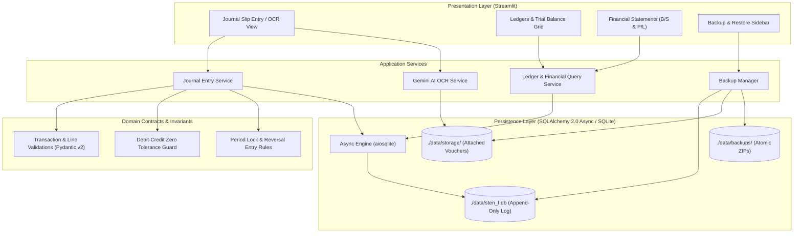
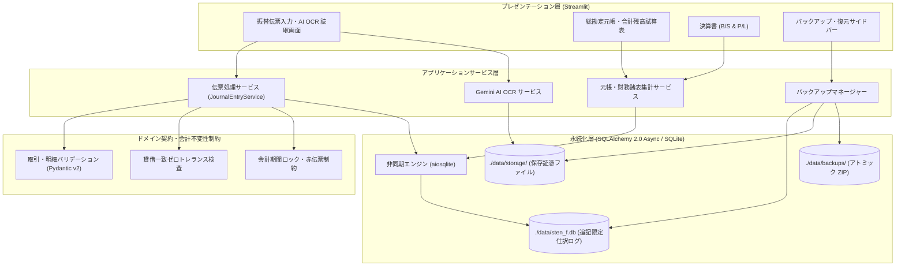

# STEN-F (Simple Tough Effective Next-generation Finance)

[](https://github.com/bottiLLC/STEN-F/actions/workflows/ci.yml)

[](https://streamlit.io/)
[](LICENSE)


[](https://pytest.org/)

[English](#english) | [日本語](#japanese)

---

## English

### Overview
**STEN-F** is a local-first, 100% pure Python double-entry bookkeeping and financial accounting application. Built with Streamlit and modern clean architecture, it fully complies with Japanese accounting principles, the Electronic Bookkeeping Act (電帳法), and the Qualified Invoice System (インボイス制度). It features multimodal AI OCR via the Google GenAI SDK to automatically transcribe invoices/receipts directly into balanced compound journal slips.

### System Architecture
STEN-F enforces a strict Monocoque Clean Architecture isolating UI, domain contracts, and asynchronous persistence.



### Directory Structure
All runtime states, local databases, logs, and attachments are strictly isolated under `./data` relative to the project root.

```
STEN-F/
├── app/                        # Monocoque Application Packages
│   ├── ai_ocr_service.py       # Gemini GenAI multimodal voucher extraction
│   ├── application_services.py # Business operations and financial workflows
│   ├── core_foundation.py      # App configuration, logging, and error handling
│   ├── domain_contracts.py     # Pydantic v2 models, entities, and validation invariants
│   ├── external_services.py    # ReportLab PDF report generation & NTA T-number lookup
│   ├── storage_repository.py   # Async SQLAlchemy repository and database schema
│   └── ui/                     # Streamlit views, layouts, and CSS design tokens
├── data/                       # STRICT DATA ISOLATION ROOT (Persistent state)
│   ├── backups/                # Verified atomic ZIP backup archives
│   ├── logs/                   # Rotated execution and audit logs
│   ├── storage/                # Stored receipt/invoice files (PDF, PNG, JPG)
│   └── sten_f.db               # SQLite database file (aiosqlite)
├── tests/                      # Pytest suite (unit, integration, characterization, fuzz)
├── app.py                      # Main Streamlit application entry point
├── backup_manager.py           # Independent atomic backup & verify engine
├── pyproject.toml              # Project metadata and locked dependency configuration
├── run.bat                     # Windows automated launcher script
└── start.command               # macOS automated launcher script
```

### Key Accounting Invariants
1. **Absolute Immutability**: Historical journal entries are strictly append-only. UPDATE and DELETE operations are prohibited at the engine boundary. Corrections are executed exclusively via reversing entries ("red slips").
2. **Zero-Tolerance Debit/Credit Balance**: Every journal slip must satisfy `SUM(debit_amount) == SUM(credit_amount)` using integer cents/yen (floating-point arithmetic is strictly banned).
3. **Dual-Timestamp Separation**: Maintains both business transaction date (`occurred_at`) and system audit recording timestamp (`recorded_at`).
4. **Fiscal Period Lock**: Closed periods (`CLOSED`) reject all posting attempts including reversal entries and opening balances.

### Environment Variables
Configure environment variables via `.env` or system environment:

| Variable | Default | Description |
| :--- | :--- | :--- |
| `GEMINI_API_KEY` | *(None / Required)* | Google Gemini API key for multimodal voucher OCR |
| `GEMINI_DEFAULT_MODEL` | `gemini-2.5-flash` | Gemini model name used for document extraction |
| `DATABASE_URL` | `sqlite+aiosqlite:///./data/sten_f.db` | Async SQLAlchemy SQLite connection string |
| `BACKUP_DIR` | `data/backups` | Target path for verified atomic backup ZIP archives |

### Setup & Execution

#### Prerequisites
- Python 3.14+
- [uv](https://github.com/astral-sh/uv) (recommended package manager)

#### Installation & Run
```bash
# 1. Clone repository
git clone https://github.com/bottiLLC/STEN-F.git
cd STEN-F

# 2. Sync dependencies
uv sync --all-groups

# 3. Configure environment
cp .env.sample .env
# Edit .env and supply GEMINI_API_KEY

# 4. Run test suite
uv run pytest -m "not fuzz"

# 5. Launch Application
uv run streamlit run app.py
```
*(On Windows, you can alternatively double-click `run.bat` for one-click bootstrap and launch).*

### Limits & Trade-offs
- **Single-Tenant Local Focus**: Designed as a single-organization, single-user desktop accounting tool running on local SQLite. Multi-tenant concurrent writes are out of scope.
- **Statutory Compliance Responsibility**: STEN-F provides tools supporting statutory accounting standards and E-Bookkeeping Act requirements, but legal audit and final tax reporting accuracy remain the user's responsibility.
- **AI OCR Cloud Quotas**: OCR transcription requires connectivity to Google Gemini API endpoints and depends on user API quota. Manual entry is always available as zero-dependency fallback.

---

## 日本語

### 概要
**STEN-F**（Simple Tough Effective Next-generation Finance）は、日本の複式簿記原則、電子帳簿保存法（スキャナ保存・優良電子帳簿要件）、および適格請求書等保存方式（インボイス制度）に完全準拠した、100% Pure Python 製のローカルファースト経理・財務会計システムです。Streamlit による洗練されたインダストリアルUIを備え、Google GenAI SDK によるマルチモーダル AI OCR により、PDF・画像証憑から取引日・適格請求書発行事業者番号（T番号）・金額・勘定科目を高精度に自動抽出し、貸借一致した振替伝票へ即座に自動展開します。

### システムアーキテクチャ
UI層、ドメイン契約層、非同期永続化層が厳格に分離された Monocoque Clean Architecture を採用しています。



### ディレクトリ構成
すべてのデータベース、証憑ファイル、ログ、バックアップアーカイブはプロジェクトルート直下の `./data` に完全に隔離・集約されます。

```
STEN-F/
├── app/                        # アプリケーションパッケージ
│   ├── ai_ocr_service.py       # Gemini GenAI による証憑 OCR 抽出
│   ├── application_services.py # 会計ビジネスロジックおよびワークフロー
│   ├── core_foundation.py      # 設定管理・構造化ログ・例外定義
│   ├── domain_contracts.py     # Pydantic v2 ドメインモデル・契約・バリデータ
│   ├── external_services.py    # ReportLab 決算書PDF生成・国税庁T番号照合
│   ├── storage_repository.py   # SQLAlchemy 2.0 Async リポジトリ & スキーマ
│   └── ui/                     # Streamlit 画面実装・レイアウト・デザイントークン
├── data/                       # 永続化データ絶対隔離ディレクトリ
│   ├── backups/                # testzip 検証済みアトミック ZIP バックアップ
│   ├── logs/                   # 日次ローテーション実行ログ
│   ├── storage/                # アップロード保存証憑ファイル (PDF, PNG, JPG)
│   └── sten_f.db               # SQLite データベース実体 (aiosqlite)
├── tests/                      # テストスイート (単体・結合・特性・ファズテスト)
├── app.py                      # Streamlit メインエントリポイント
├── backup_manager.py           # 独立実行可能なバックアップ・整合性検証エンジン
├── pyproject.toml              # プロジェクト構成および依存関係定義
├── run.bat                     # Windows 用自動セットアップ＆起動スクリプト
└── start.command               # macOS 用自動セットアップ＆起動スクリプト
```

### 会計コア不変性制約
1. **仕訳の完全不変性（Append-Only）**: 仕訳テーブルに対する `UPDATE` および `DELETE` の実行は厳格に禁止されています。入力誤りの訂正は、貸借を反転させた「赤伝票（反対仕訳）」の起票によってのみ行われ、完全な監査証跡が担保されます。
2. **貸借ゼロトレランス（Debit-Credit Equality）**: 金銭計算における浮動小数点数（Float）の使用を完全排除し、整数型で計算されます。`SUM(借方金額) == SUM(貸方金額)` を満たさない伝票は永続化を拒絶します。
3. **二重タイムスタンプ分離**: 取引発生日（`occurred_at`）とシステム記録日時（`recorded_at` UTC）の2軸を厳格に保持します。
4. **会計期間ロック（Fiscal Period Lock）**: 決算確定済みの締日年度（`CLOSED`）に対する仕訳起票・赤伝起票・期首残高登録はすべて遮断されます。

### 環境変数設定
`.env` ファイルまたはシステム環境変数で設定します：

| 環境変数名 | デフォルト値 | 説明 |
| :--- | :--- | :--- |
| `GEMINI_API_KEY` | *(未設定 / 必須)* | Google Gemini API キー（AI OCR 証憑読取機能に必要） |
| `GEMINI_DEFAULT_MODEL` | `gemini-2.5-flash` | OCR推論に使用するデフォルト Gemini モデル識別子 |
| `DATABASE_URL` | `sqlite+aiosqlite:///./data/sten_f.db` | 非同期 SQLAlchemy 接続文字列 |
| `BACKUP_DIR` | `data/backups` | 自動バックアップ ZIP アーカイブの出力先ディレクトリ |

### セットアップと実行方法

#### 前提要件
- Python 3.14 以上
- [uv](https://github.com/astral-sh/uv)（推奨パッケージマネージャー）

#### 手順
```bash
# 1. リポジトリのクローン
git clone https://github.com/bottiLLC/STEN-F.git
cd STEN-F

# 2. 依存関係の同期
uv sync --all-groups

# 3. 環境設定
cp .env.sample .env
# .env を編集して GEMINI_API_KEY を設定

# 4. テストの実行
uv run pytest -m "not fuzz"

# 5. アプリケーションの起動
uv run streamlit run app.py
```
*(Windows 環境では、ルートディレクトリの `run.bat` をダブルクリックするだけで環境構築とアプリ起動が全自動で完了します)*

### 制約事項とトレードオフ
- **シングルテナント排他仕様**: SQLite を基盤とした単一事業者・デスクトップ向けの設計であり、複数ユーザーからの同時書き込みトランザクションは対象外としています。
- **税務申告の利用者自己責任**: 本システムは複式簿記および電帳法・インボイス制度の要件支援を提供しますが、帳簿の適法性および確定申告書類の最終妥当性は利用者が自己の責任において確認・判断するものとします。
- **外部 API 依存とフォールバック**: AI OCR は Google Gemini API を利用するため、API の利用制限（Quota）やネットワーク切断時には手動での伝票起票へフォールバックして運用を継続できます。

---
Copyright (C) 2026 合同会社ぼっち (bottiLLC). All rights reserved.
